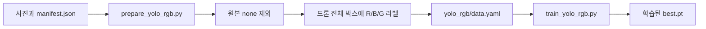
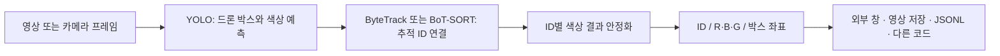

# 드론 색상 탐지와 영상 추적: 코드 동작 로직

이 폴더에는 드론 정지사진 데이터, 표식 픽셀 판별 코드, YOLO 학습 코드, 영상 추적 코드가 들어 있습니다. 색상의 의미는 **빨강 `R`, 파랑 `B`, 초록 `G`**입니다.

**현재 상태:** GPU PC에서 실행할 코드를 준비했습니다. YOLO 학습·추론·추적 테스트는 아직 실행하지 않았고, 학습된 `best.pt`와 정확도 수치는 포함하지 않습니다. 기존 `validation_report.json`의 `PASS`는 데이터 파일·라벨 구조에 대한 기록입니다.

## 경량 묶음에서 학습 자료 복원

현재 폴더에는 코드·manifest·출처·검사 기록을 남겼습니다. 사진·라벨·COCO annotations·미리보기는 실행 용량을 줄이기 위해 `wan_V1_original.zip`에 분리했습니다. 원본 ZIP을 `wan_V1` 폴더 옆에 두고 `python restore_training_data.py`를 실행하면 기존 구조로 복원합니다. 다른 위치의 ZIP은 `--archive "원본 ZIP 경로"`로 지정합니다. 복원 전에는 데이터 변환·검증·픽셀 판별·미리보기를 사용할 수 없습니다. 학습된 모델을 사용하는 영상 추적에는 학습 사진이 필요하지 않습니다.

## 1. 전체 흐름

### YOLO 학습



### 영상 추적



YOLO가 **현재 프레임의 드론 위치와 색상 클래스**를 예측하고, 선택한 추적기가 **앞 프레임의 드론과 연결하여 ID**를 유지합니다. 두 추적기 중 하나를 선택합니다. 추론 시에는 `manifest.json`, 정답 박스, 파일명의 색상을 사용하지 않습니다.

`classify_rgb.py`는 별도 실행 경로입니다. 이미 알려진 표식 위치의 픽셀을 읽는 규칙이며, YOLO 영상 추적 코드에서 호출하지 않습니다.

## 2. 파일별 역할

| 파일 | 입력 | 수행 작업 | 출력 |
|---|---|---|---|
| `build_dataset.py` | 원본 COCO ZIP | 사진 선정·분할·색상 표식 합성 | 사진, 라벨, manifest, 미리보기 |
| `validate_dataset.py` | 제작된 데이터 폴더 | 파일 해시·좌표·분할 구조 검사 | 구조 검사 결과 |
| `classify_rgb.py` | 사진 + 알려진 표식 박스 | 중앙 픽셀의 색조·채도·밝기 판별 | `R/B/G/UNKNOWN`, CSV |
| `prepare_yolo_rgb.py` | 사진 + manifest | 원본 제외, 드론 전체 박스를 3클래스로 변환 | `yolo_rgb/` |
| `train_yolo_rgb.py` | 변환된 데이터 + 사전학습 모델 | GPU에서 드론 위치·색상 전이학습 | `best.pt`, `last.pt`, 학습 기록 |
| `track_yolo_rgb.py` | 학습된 모델 + 연속 프레임 | 탐지·ID 연결·색상 안정화 | 프레임별 추적 정보 |
| `drone_coordinates.py` | 드론 박스 중심 + 촬영 자세 | 시작 방향을 북쪽으로 잡아 ENU 방향 계산 | 방향 벡터·방위·고도각 |
| `coordinate_imu.py` | 기존 NU40 서버 각속도 | 화면 감도와 독립적인 연속 자세 누적 | 촬영 시점 자세 |

## 3. 데이터와 라벨 구조

원본 300장마다 `none/red/blue/green` 네 버전이 있어 총 1,200장입니다. `none`은 합성 표식을 추가하지 않았다는 뜻이며, 사진 안에 색상이 전혀 없다는 뜻은 아닙니다.

| 데이터 | 학습 train | 검증 val | 최종 시험 test | 합계 |
|---|---:|---:|---:|---:|
| 기존 데이터: 원본 포함 | 840 | 240 | 120 | 1,200 |
| YOLO R/B/G 변환 후: 원본 제외 | 630 | 180 | 90 | 900 |

같은 원본에서 나온 세 색상 사진은 같은 분할에 유지합니다. 학습 중에는 `train`과 `val`을 사용하며 `test`를 자동으로 평가하지 않습니다.

| 경로 | 박스가 감싸는 대상 | 클래스 |
|---|---|---|
| 기존 `labels/` | 드론 전체 | `0=drone` |
| 기존 `marker_labels/` | 작은 색상 표식 | `0=red, 1=blue, 2=green` |
| 새로 생성되는 `yolo_rgb/labels/` | 해당 색상 표식을 가진 드론 전체 | `0=R, 1=B, 2=G` |

YOLO 추적용 학습에서는 **드론 전체 박스**를 사용합니다. `marker_labels/`의 작은 표식 박스를 학습용 드론 박스와 합치지 않습니다. 기존 `data.yaml`은 `drone` 한 클래스용이고, 새 학습은 `yolo_rgb/data.yaml`을 사용합니다.

## 4. 데이터 변환 로직 — `prepare_yolo_rgb.py`

1. `manifest.json`을 읽고 `marker_color == "none"`인 원본을 제외합니다.
2. 색상 속성을 학습 정답 `red→0`, `blue→1`, `green→2`로 바꿉니다. **학습 데이터 제작 단계에서는 색상 정답을 사용합니다.**
3. 원본 그룹이 여러 분할에 섞이지 않았는지, 사진이 데이터 폴더 안에 있는지, 사진 SHA-256이 manifest와 같은지 확인합니다.
4. 중복 출력 이름, 이미지 크기, 드론 박스 범위를 확인합니다.
5. manifest의 드론 `bbox=[x,y,w,h]`를 YOLO 좌표로 변환합니다. 이미지 크기를 `W,H`라고 하면 한 라벨 행은 다음과 같습니다.

   ```text
   class_id  (x+w/2)/W  (y+h/2)/H  w/W  h/H
   ```

6. 사진을 새 `images/<split>/`에 복사하고 라벨을 `labels/<split>/`에 씁니다. 클래스 이름과 상대 경로는 새 `data.yaml`, 변환 개수와 원본 manifest 해시는 `conversion.json`에 기록합니다.

기존 사진·라벨은 변경하지 않습니다. 임시 폴더에서 제작을 마친 뒤 출력 폴더로 바꾸며, 이미 존재하는 출력 폴더는 덮어쓰지 않습니다.

## 5. YOLO 학습 로직 — `train_yolo_rgb.py`

기본 사전학습 모델 `yolo11n.pt`를 가져와 **R/B/G 3클래스 드론 탐지**로 전이학습합니다. 사진의 드론 위치와 색상 클래스를 함께 학습합니다. 색상 표식 위치를 별도 출력하도록 학습하는 구성은 아닙니다.

| 기본 설정 | 값 | 의미 |
|---|---|---|
| `device` | `0` | 첫 번째 CUDA GPU. GPU가 없으면 오류로 안내 |
| `epochs` | `80` | 최대 학습 반복 수 |
| `batch` | `8` | 한 번에 처리할 사진 수 |
| `imgsz` | `640` | 학습 입력 크기 |
| `workers` | `2` | 데이터 로딩 작업 수 |
| `patience` | `20` | 검증 성능 개선이 없을 때 조기 종료 기준 |
| `seed` | `20261010` | 난수 시드 |

색상이 정답이므로 코드에서 `hsv_h=0`, `hsv_s=0`, `bgr=0`을 지정하여 색조·채도 증강과 RGB 채널 교환을 끕니다. 밝기는 `hsv_v=0.15`, 좌우 반전은 `fliplr=0.5`를 사용합니다. 작은 표식의 단서를 보존하도록 mosaic·mixup·cutmix·copy-paste, 이동·크기·회전 증강도 0으로 지정합니다.

학습 중 `val` 분할로 모델을 평가하고, 기본 출력은 다음과 같습니다.

- `runs_rgb/drone_rgb/weights/best.pt`: Ultralytics의 검증 기준으로 선택한 모델
- `runs_rgb/drone_rgb/weights/last.pt`: 마지막 체크포인트. `--resume`으로 이어 학습할 때 사용
- 학습 로그·그래프: 같은 실행 결과 폴더에 저장

같은 이름의 실행 결과가 있으면 `drone_rgb2` 등 새 폴더를 사용합니다. 실제 출력 경로는 학습 종료 메시지를 확인하세요. 시드를 고정해도 GPU·라이브러리 환경이 달라지면 결과가 완전히 같다고 보장되지는 않습니다.

## 6. 탐지와 추적 로직 — `track_yolo_rgb.py`

### 6-1. 모델과 프레임 입력

`RGBTracker`를 생성할 때 가중치 파일이 존재하는지 확인하고, 탐지 모델의 클래스가 정확히 `{0:R, 1:B, 2:G}`인지 확인합니다. 기본 COCO 모델을 그대로 넣으면 오류로 중단합니다.

OpenCV의 BGR 프레임을 `update(frame)`에 전달하면 내부에서 `model.track(..., persist=True)`를 호출합니다. 같은 영상에서는 같은 `RGBTracker` 객체를 재사용하여 프레임 사이의 추적 상태를 유지합니다. 다른 영상으로 바꿀 때는 객체를 새로 만듭니다.

### 6-2. 탐지 박스와 ID 연결

- YOLO의 탐지 입력 신뢰도 기본값은 `0.1`입니다. 낮은 신뢰도 탐지도 추적기의 연결 판단에 전달하기 위한 값입니다.
- `iou=0.7`, `agnostic_nms=True`를 사용하여 같은 드론에 겹쳐 나오는 색상 클래스 박스를 억제합니다. 이는 탐지 중복 억제 설정이며 추적기 연결 임계값과는 별개입니다.
- `--tracker bytetrack`이면 패키지의 `bytetrack.yaml`, `--tracker botsort`이면 `botsort.yaml`을 사용합니다.
- ID 연결은 Ultralytics가 제공하는 추적기가 수행합니다. 자체 추적 알고리즘을 새로 학습하는 코드는 아닙니다.

| 추적기 | 연결 방식의 요점 | 이 코드의 사용 방식 |
|---|---|---|
| ByteTrack | 높은 점수 탐지로 먼저 연결하고 낮은 점수 탐지도 기존 궤적 연결에 활용 | 기본 선택 |
| BoT-SORT | 위치·움직임 기반 연결에 카메라 움직임 보정 등을 사용 | `--tracker botsort`로 선택. 패키지 기본 ReID는 꺼져 있음 |

추적 ID는 **현재 실행 세션 안의 번호**입니다. 가림·화면 이탈·비슷한 드론의 교차 등에서는 ID가 바뀌거나 서로 교환될 수 있습니다.

### 6-3. 색상 결과 안정화와 `UNKNOWN`

YOLO가 바로 낸 색상은 `raw_code`, 최종 표시할 색상은 `code`입니다.

1. 현재 탐지 신뢰도가 `--color-conf`보다 낮으면 `code=UNKNOWN`입니다. 기본값은 `0.4`입니다.
2. 추적 ID가 있으면 **같은 ID의 최근 최대 7회 관측 결과**를 저장합니다. 드론이 안 보인 프레임은 관측 목록에 추가하지 않습니다.
3. 기준을 넘은 관측만 각 색상에 탐지 신뢰도만큼 가중치를 더합니다. 기준 미달 관측은 0점으로 기록합니다.
4. 현재 관측도 기준을 넘었고, 가장 많은 가중치를 받은 색상이 전체 유효 가중치의 **65% 이상**이면 그 색상을 표시합니다. 아니면 `UNKNOWN`입니다.
5. 현재 신뢰도가 낮으면 과거의 확실한 색상으로 덮어쓰지 않습니다. 추적 ID가 아직 없는 탐지는 현재 신뢰도만으로 판별합니다.
6. 같은 ID의 관측 간격이 30프레임을 넘으면 색상 기록을 초기화하고, 120프레임 넘게 나타나지 않은 ID는 색상 기록에서 제거합니다. 이는 앱의 색상 기록 관리이며 추적기 내부의 생존 기간과 별개입니다.

따라서 순간적인 색상 흔들림은 줄일 수 있지만, 색상 변경이 표시되기까지 지연이 생길 수 있습니다. `UNKNOWN`은 학습한 네 번째 클래스가 아니라 코드가 판단을 보류하는 상태입니다.

### 6-4. 출력과 다른 코드 연동

`RGBTracker.update(frame)`은 객체 목록을 반환합니다. 아래는 실제 측정값이 아닌 **출력 형식 예시**입니다.

```json
{"id": 1, "code": "R", "raw_code": "R", "confidence": 0.91, "xyxy": [10, 20, 100, 120]}
```

| 필드 | 의미 |
|---|---|
| `id` | 추적 ID. 아직 배정되지 않았으면 `null` |
| `code` | 안정화 후 표시할 `R/B/G/UNKNOWN` |
| `raw_code` | 현재 YOLO가 예측한 색상 클래스 |
| `confidence` | 현재 YOLO 탐지 신뢰도. 누적 투표 신뢰도는 아님 |
| `xyxy` | 입력 프레임 기준 픽셀 좌표 `[왼쪽, 위쪽, 오른쪽, 아래쪽]` |

탐지가 없으면 빈 목록을 반환합니다. CLI는 프레임 번호와 객체 목록을 JSONL로 출력합니다. `--jsonl`로 파일에 저장할 수 있고, `--save-video`로 박스를 그린 MP4를 저장할 수 있습니다. `--show`를 지정했을 때만 외부 OpenCV 창이 열립니다.

```python
from track_yolo_rgb import RGBTracker

tracker = RGBTracker("best.pt", tracker="botsort", device="0")
# 카메라/영상 루프 안에서 OpenCV BGR 프레임을 전달
tracks = tracker.update(frame)
for item in tracks:
    # 하늘마루 UI나 통신 코드에 전달할 값
    print(item["id"], item["code"], item["xyxy"])
```

현재는 이 결과를 기존 하늘마루 렌더러·NUCODE·IMU에 자동 전달하는 연결까지 구현되어 있지는 않습니다.

## 7. 별도 픽셀 판별 로직 — `classify_rgb.py`

이 코드는 학습 모델 없이 **알려진 표식 박스의 중앙 픽셀**로 색상을 판별합니다. 데이터셋에서는 manifest의 파일 경로와 `marker_bbox`를 사용하고, 새 사진은 `--bbox X Y W H`로 표식 위치를 지정합니다. 파일명의 `red/blue/green`, `marker_color`, 색상 라벨 번호로 결과를 정하지 않습니다.

1. 박스 안에서 반지름이 짧은 변의 30%인 중앙 원 영역을 샘플링합니다. 검정·흰색 테두리를 피하기 위한 선택입니다.
2. RGB 픽셀을 HSV로 변환합니다. 채도 0.40 미만 또는 밝기 0.20 미만인 픽셀은 색상 투표에서 제외합니다.
3. 색조가 아래 범위이면 해당 색상에 한 표를 줍니다.

   | 색상 | HSV 색조 범위, 도 |
   |---|---|
   | R | 0–25 또는 340–360 |
   | G | 75–165 |
   | B | 190–255 |

4. 샘플이 3개 이상이고, 최다 색상 표가 전체 샘플의 65% 이상이며, 2등과의 표 차이가 전체 샘플의 30% 이상일 때 해당 문자를 반환합니다. 나머지는 `UNKNOWN`입니다. 제외된 픽셀도 전체 샘플 수에는 포함됩니다.

일괄 처리에서는 `marker_bbox`가 없는 원본을 제외합니다. YOLO 경로의 `UNKNOWN`은 탐지 신뢰도·관측 투표로 결정하고, 이 픽셀 경로의 `UNKNOWN`은 픽셀 분포로 결정합니다.

## 8. GPU PC에서 실행하는 순서

Python 환경과 CUDA 지원 PyTorch를 준비한 뒤 이 폴더에서 실행합니다. 자세한 설치·재개·출력 옵션은 [YOLO_추적_사용법.txt](YOLO_추적_사용법.txt)를 참고하세요.

```bash
python -m pip install -r requirements-yolo.txt
python prepare_yolo_rgb.py
python train_yolo_rgb.py --device 0 --epochs 80 --batch 8
python track_yolo_rgb.py --weights runs_rgb/drone_rgb/weights/best.pt --source input.mp4 --tracker bytetrack --device 0 --show
```

- BoT-SORT: 마지막 명령의 `--tracker botsort`
- 카메라: `--source 0`
- CPU 추론: `--device cpu`
- 결과 저장: `--jsonl tracks.jsonl --save-video tracked.mp4`
- 별도 픽셀 판별: `python classify_rgb.py --output rgb_results.csv`

외부 화면은 요청된 실행 옵션에 따라 열리며, 코드를 내려받는 것만으로 열리지 않습니다. 결과 파일은 새 이름을 사용하세요.

## 9. 데이터 제작 과정과 해석 범위

`build_dataset.py`는 문서화된 원본 COCO ZIP에서 객체가 하나이고 드론 박스 짧은 변이 120px 이상인 사진을 후보로 고릅니다. 파일명·디코딩된 픽셀 해시·dHash64 거리 4 이하의 유사 사진을 제외하고 원본 300장을 선정합니다. 원본 단위로 70/20/10 분할한 뒤 같은 위치·크기·밝기 조건으로 빨강·파랑·초록 원형 표식을 합성합니다. 기본 seed는 `20261010`입니다.

표식은 사진 위에 합성한 2D 그래픽이며, 기체 표면에 붙인 실물 표식을 촬영한 자료는 아닙니다. 중심 배치 방식이라 빈 공간에 걸칠 수도 있습니다. 원본은 이미 620×620으로 변환된 이미지입니다.

- 데이터 제작·변환 시 수행하는 구조 검사는 모델 정확도 측정이 아닙니다.
- 정지사진에는 프레임별 추적 ID 정답이 없어 추적 성능을 평가할 수 없습니다. 실제 연속 영상이 필요합니다.
- 표식이 작거나 가려지면 YOLO의 색상 분류가 흔들릴 수 있습니다.
- `none`은 학습에서 제외하므로 표식 없는 드론을 자동으로 `NONE` 분류하도록 학습하지 않습니다.
- 배경만 있는 음성 사진도 포함하지 않아 배경 오탐 성능은 별도 평가가 필요합니다.
- 이 코드 업데이트에서는 학습·추론·테스트를 실행하지 않았습니다.

### 원본 데이터 재생성과 미리보기

원본 COCO ZIP을 별도로 준비했다면 다음 명령으로 새 폴더에 다시 만들 수 있습니다. 같은 원본 ZIP·seed·Pillow 버전을 사용해야 재현 조건이 같습니다.

```bash
python -m pip install -r requirements.txt
python build_dataset.py --source "Drone-Detection.v1i.coco.zip" --output "photo_color_v2" --count 300
python validate_dataset.py "photo_color_v2"
```

`미리보기.html`은 기존 사진의 분할·색상 필터와 정답 표시를 제공하는 오프라인 뷰어입니다. 모델 추론 화면은 아니며 필요할 때 직접 열 수 있습니다.

## 10. 출처 및 참고

기존 데이터의 출처는 AI / Drone-Detection v1, Roboflow Universe입니다. 제공자가 명시한 라이선스는 CC BY 4.0이며, 세부 제작 정보는 [DATASET_CARD.txt](DATASET_CARD.txt), [build_report.json](build_report.json)에 보존되어 있습니다. 일부 원본의 상용 사진 워터마크와 개별 사진 권리를 확인하지 못했다는 기존 기록도 유지합니다. 정리 전 자료에는 사용자 요청으로 사진과 라벨 폴더가 함께 포함되어 있습니다. 경량 묶음은 원본 ZIP에서 이를 복원하여 사용합니다.

- [원본 데이터셋](https://universe.roboflow.com/ai-bmkoo/drone-detection-inlmy/dataset/1)
- [YOLO11 공식 문서](https://docs.ultralytics.com/models/yolo11/)
- [Ultralytics 학습 문서](https://docs.ultralytics.com/modes/train/)
- [Ultralytics 추적 문서](https://docs.ultralytics.com/modes/track/)
- [픽셀 판별 실행 방법](RGB_사용법.txt)

모델·추적 실행 의존성은 `requirements-yolo.txt`에 명시한 `ultralytics==8.4.63`을 기준으로 합니다.

## S22 카메라 기준 정보

현재 확인된 기준 정보는 `camera_calibration_s22/reference_info.json`에 기록되어 있습니다. Samsung Galaxy S22 (`SM-S901N`) 후면 1배율로 촬영했고, 카메라와 자 사이 거리는 30cm입니다. 자의 전체 실제 길이는 31cm이며, 눈금 구간은 0–30cm입니다. 기준 사진 3장도 `camera_calibration_s22/reference_images/`에 보관합니다.

이 파일은 알려진 사실만 보관하며 카메라 보정값, 물체까지의 거리, 물체 실측 크기를 계산하지 않습니다. 이후 사용 목적과 촬영 정보가 정해지면 그에 맞게 코드를 추가합니다. 사진은 로컬 작업 폴더에 보관합니다.


## 드론 시스템 좌표

촬영을 시작한 방향을 북쪽 0°로 잡고, 드론 탐지 박스 중심을 ENU(동쪽·북쪽·위쪽) 방향 좌표로 기록합니다. 원점은 시작 카메라 위치이며 현재는 제자리에서 회전한다고 가정합니다. 드론 거리와 실제 공간 위치는 미정입니다.

`track_yolo_rgb.py`의 기본 출력은 `system_coordinates`를 포함합니다. `--show` 없이 `--jsonl`로 저장할 수 있습니다. `--imu-host-url`로 기존 NU40 서버를 지정하면 USB 우선·BLE 유지 입력을 받아 각속도를 연속 누적합니다. 이 누적은 강한 방향 표시의 기준과 화면 감도에 영향을 받지 않습니다. 외부 코드에서 자세를 공급하려면 `--pose-json` 또는 `NorthCoordinateSession.record()`를 사용합니다.

`drone_coordinate_config.json`의 55° 수직 화각은 기존 가상 렌더러의 임시 모델이며 실제 S22 보정값이 아닙니다. 결과에 추정 여부를 표시합니다. 카메라 기준 자의 30cm 촬영 거리는 드론 거리로 사용하지 않습니다. 학습된 모델은 아직 없어 실제 드론 자동 탐지는 GPU PC에서 학습한 뒤 연결합니다. [좌표 로직·실행·다른 코드와의 연동](SYSTEM_COORDINATES.md)을 참고하세요.

## 카메라 사양 추가 정보

알려주신 카메라 정보는 화각 약 85°(가로·세로·대각선 기준 미확인), 조리개 f/1.8입니다. 화각 기준을 확인하기 전까지 85°는 방향 계산에 적용하지 않고 기존 임시 수직 화각 55°를 유지합니다. 조리개는 기록용이며 방향 벡터 계산에는 사용하지 않습니다.
